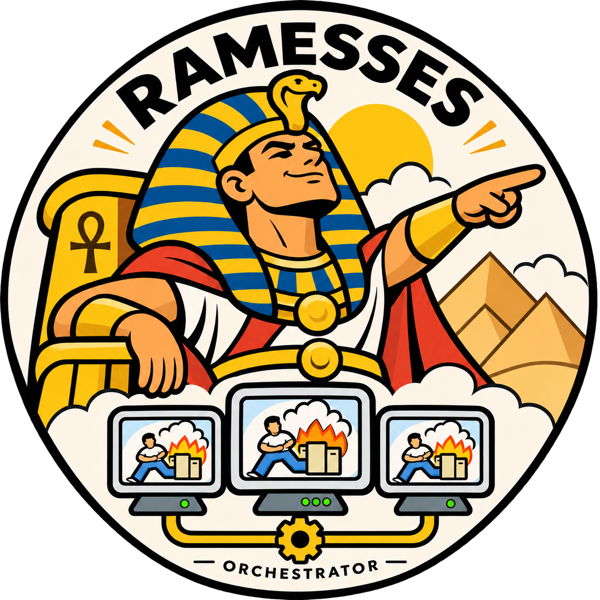

<p align="center">
  
</p>

# ramesses

Fleet management for [Archive Team Warrior](https://wiki.archiveteam.org/index.php/ArchiveTeam_Warrior) instances. v0.1 is a live dashboard: the backend keeps one SockJS session open to every warrior, reduces its events into a snapshot, and pushes that state to browsers over a WebSocket: a full snapshot on connect, then only the events that changed it.

```
apps/server    NestJS 12 (Fastify, ws, TypeORM/Postgres, Redis, pino, Swagger)
apps/web       Svelte 5 + Vite + Tailwind 4 + daisyUI 5
packages/shared  Shared types (warrior events, snapshots, ws protocol, REST records) and the event reducer both sides run
```

## Run it locally

Requirements: Node 26, pnpm 12, Docker (for Postgres and Redis).

```sh
pnpm install
cp .env.example .env          # defaults match docker-compose.yml
docker compose up -d          # Postgres on 5433, Redis on 6380
pnpm dev                      # backend on :3000, web on :5173
```

Open http://localhost:5173. On first run you are asked for your warriors' addresses (`host[:port]`, port defaults to 8001). The list is stored in Postgres and can be changed later from **Manage warriors**. API docs: http://localhost:3000/api/docs.

Migrations run automatically at boot. To run them by hand: `pnpm --filter @ramesses/server migration:run`.

### Configuration

Every setting is an environment variable with a default; `.env.example` lists them all. The ones you are most likely to change:

| Variable | Default | What it does |
| --- | --- | --- |
| `DATABASE_URL`, `REDIS_URL` | (required) | Postgres and Redis connections. |
| `METRICS_RETENTION_SEC`, `METRICS_WINDOW_SEC` | `900`, `300` | How long raw bandwidth samples live in Redis, and the window the dashboard averages over. |
| `PROJECTS_SAMPLING_ENABLED` | `true` | Fetch the Archive Team project catalog and each project's tracker numbers on a schedule. Set to `false` to work offline. |
| `PROJECTS_SAMPLE_INTERVAL_SEC` | `900` | How often the tracker is sampled (minimum 300). Items per hour and queue health are derived from these samples, so history is kept in Postgres. |
| `PROJECTS_RETENTION_DAYS` | `90` | How long raw project samples are kept. |
| `PROJECTS_REFRESH_MIN_SEC` | `300` | Minimum gap between sample runs; `POST /api/projects/refresh` is throttled to it. |
| `TRACKER_PROJECTS_URL`, `TRACKER_STATS_URL_TEMPLATE` | the Archive Team endpoints | Where the catalog and per-project stats come from. Point them at a local server for testing. |
| `REDIS_KEY_PREFIX` | `ramesses` | Namespace for the leader key and pub/sub channels, so several deployments can share one Redis. |
| `LEADER_TTL_MS`, `LEADER_RENEW_MS` | `30000`, `10000` | Leader lease length and renew cadence (see below). |
| `WEB_DIST` | unset | Serve the built web app from the backend (the production image sets it). |

Several backend replicas can run against the same Postgres and Redis. Jobs that must happen once across the fleet, such as tracker sampling, run only on the replica holding a Redis lease: every replica tries to take the key, the holder renews it while alive, and when it stops renewing the key expires and another replica takes over within about a lease length. `GET /api/health/ready` reports `leader: true` on the holder.

## Verify

```sh
pnpm typecheck
pnpm lint
pnpm test                # unit + integration + e2e (needs docker compose up)
pnpm test:coverage       # same, with coverage; CI enforces 90% lines/statements/functions and 80% branches per area
pnpm test:e2e            # Playwright browser tests (one-time: pnpm --filter @ramesses/web exec playwright install chromium)
```

Integration and e2e tests use a separate `ramesses_test` database derived from `DATABASE_URL` (or `DATABASE_URL_TEST`), created on demand, so they never touch development data.

## Production image

```sh
docker build -t ramesses .
docker run -p 3000:3000 -e DATABASE_URL=... -e REDIS_URL=... ramesses
```

One container serves the API, the WebSocket, and the built web app.

## Roadmap

Tentative ordering; themes may be reshuffled.

- **v0.2 Projects.** A projects page built from the tracker: the project catalog plus each project's tracker numbers (todo, out, done, downloaders) sampled over time so a rate can be derived, and basic project management (preferred, ignored, pinned).
- **v0.3 Instances.** Manage warriors from Ramesses: select and stop projects through the warrior API, and suggest projects per warrior from the v0.2 data (most need, fewest contributors).
- **v0.4 Metrics.** Push bandwidth and item outcomes to InfluxDB through the existing `MetricsSink` seam.

## How the warrior protocol works

Each warrior exposes a SockJS server at the root of its web port. Ramesses connects to the session path `ws://host:port/<server>/<session>/websocket` and receives `{"event_name", "message"}` envelopes: a connect burst (`instance_id`, `project.refresh`, `warrior.projects_loaded`, `warrior.status`, `warrior.broadcast_message`), then `bandwidth` and `timestamp` every second, plus item lifecycle events. Type definitions live in `packages/shared/src/warrior-events.ts`.

There is no written spec; the protocol is defined by the warrior's own code in [ArchiveTeam/seesaw-kit](https://github.com/ArchiveTeam/seesaw-kit): [`seesaw/web.py`](https://github.com/ArchiveTeam/seesaw-kit/blob/development/seesaw/web.py) mounts the SockJS router, defines every event name and payload (`SeesawConnection`, `ItemMonitor`), and handles the `POST /api/<command>` controls (`stop`, `stop_now`, `keep_running`, `select-project`, `deselect-project`, `settings`); [`seesaw/public/script.js`](https://github.com/ArchiveTeam/seesaw-kit/blob/development/seesaw/public/script.js) is the stock UI that consumes them. The official image, [ArchiveTeam/warrior-dockerfile](https://github.com/ArchiveTeam/warrior-dockerfile), installs seesaw-kit through [ArchiveTeam/warrior-code2](https://github.com/ArchiveTeam/warrior-code2). The event shapes in this repo were recorded from live warriors and checked against that source.
